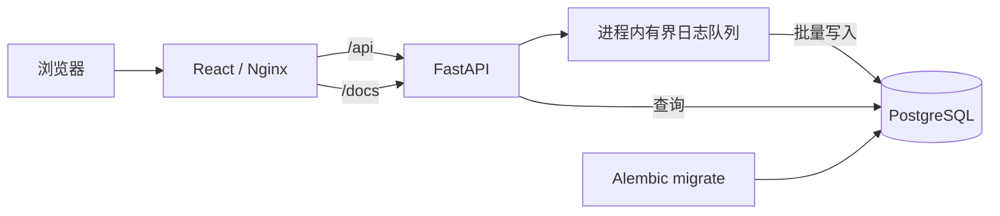

# 架构设计

## 目标

提供一个可复用的轻量 Monorepo 模板，支持 FastAPI HTTP 服务、PostgreSQL 请求日志持久化、React 日志查看、Docker Compose 开发与部署，并以单实例约 100 个并发请求为设计基线。

## 系统拓扑



## Monorepo 边界

```text
backend/             FastAPI 应用、迁移与测试
frontend/            React、ShadCN 与 Nginx 配置
docs/                架构和开发规范
compose.yaml         公共及生产拓扑
compose.dev.yaml     开发热重载覆盖
.env.example         环境变量契约
```

后端和前端独立构建。生产环境由 Nginx 提供前端静态文件并反向代理 API；开发环境由 Vite 代理 API。

## 请求链路

1. 客户端发起 HTTP 请求。
2. 日志 ASGI 中间件捕获请求头、查询参数和有限大小的正文。
3. FastAPI 执行业务路由并返回响应。
4. 中间件捕获状态码、响应头、响应正文、耗时和异常。
5. 日志事件以非阻塞方式进入有界队列；业务响应不等待 PostgreSQL 单条写入。
6. 后台任务按批次写入 PostgreSQL，并按配置周期清理过期日志。

## 100 并发基线

- ASGI 全异步请求链路。
- PostgreSQL 连接池默认 `20 + 20 overflow`，池等待超时 10 秒。
- 日志队列默认容量 10,000，单批最多 100 条，最长等待 0.5 秒后写入。
- 队列满时丢弃新日志并写 stderr，避免日志系统拖垮业务请求。
- 日志查询使用服务端分页，每页最多 100 条。
- 正文默认最多保存 256 KiB，超过后记录截断标记，避免单请求占用无界内存。

该基线是容量设计，不等同于压测结论。迁移到带 PostgreSQL 镜像的环境后，应对 GET、POST、正文大小和日志查询分别执行压测，再调整连接池、队列和批量参数。

## 认证边界

- `ADMIN_PASSWORD` 仅在后端读取，不注入前端构建产物。
- 登录成功后返回签名的 HttpOnly、SameSite=Lax Cookie。
- Cookie 由 `AUTH_SECRET` 签名并受会话有效期约束。
- 生产 HTTPS 环境必须设置 `AUTH_COOKIE_SECURE=true`。
- 日志 API 需要管理员会话；Mock API 和 Swagger 默认公开，部署方可在反向代理层进一步限制。

## 开发与生产差异

开发模式通过 `compose.dev.yaml` 将宿主机 `./backend/src` 映射到容器 `/app/src`，并使用 Uvicorn `--reload`。前端映射 `./frontend/src` 并使用 Vite HMR。

生产模式不挂载源码、不启用 reload，FastAPI 使用 exec 形式命令，前端使用 Nginx 静态服务。

## 健康检查

- `/health/live`：仅确认进程存活。
- `/health/ready`：执行 `SELECT 1`，确认数据库可用。
- Compose 先等待 PostgreSQL 健康，再执行迁移，迁移成功后启动 API。

## 已知边界

- 日志队列位于单进程内；多实例部署时各实例独立写入同一 PostgreSQL。
- 进程被强制终止可能丢失尚未刷新的队列数据。
- 大流量或强可靠日志场景应将队列替换为 Redis Streams、RabbitMQ、Kafka 或专用日志系统。

